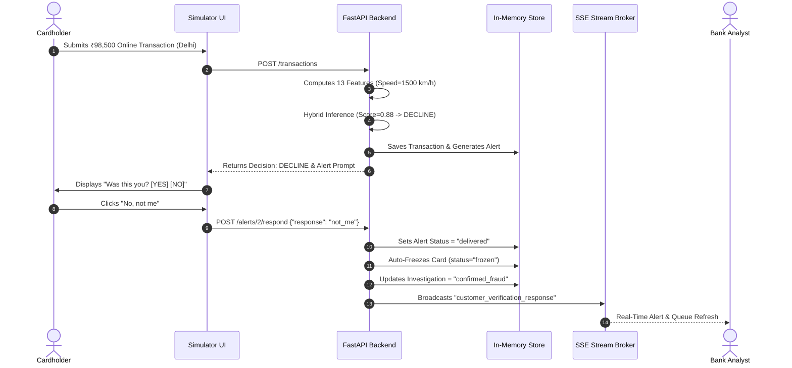

# FraudSentinel – Backend Architecture & Engine System Guide

---

## 1. Overview & Technology Stack

The FraudSentinel backend is an enterprise-grade asynchronous REST API and real-time streaming engine built for high-throughput transaction scoring, automated risk policy enforcement, explainable AI attribution, and financial risk prioritization.

### Core Technologies
* **Language & Runtime:** Python 3.11 (optimized typing & dataclasses)
* **Web Framework:** FastAPI 0.115+ (Asynchronous ASGI framework with auto-generated OpenAPI 3.0 / Swagger docs)
* **Application Server:** Uvicorn 0.30+ (High-performance ASGI server binding to `$PORT` on Render)
* **Storage Architecture:** **Zero-Database In-Memory State Engine** (`MemoryStore`) with thread-safe `RLock` synchronization. Eliminates SQLite concurrency locks, connection pooling overhead, and cloud database costs.
* **Authentication:** JWT (JSON Web Tokens via PyJWT) with salted password hashing (Bcrypt) and Role-Based Access Control (RBAC: `analyst`, `admin`, `auditor`).
* **Real-time Event Streaming:** Asynchronous in-memory pub/sub broker broadcasting Server-Sent Events (SSE) to active frontend clients.
* **External Integration:** Modular 2-way SMS service (Simulated loop by default, plug-and-play MSG91 integration).

---

## 2. Directory & Module Structure

```
backend/
├── requirements.txt             # Minimal production dependencies (FastAPI, Uvicorn, LightGBM, SHAP, etc.)
├── alembic.ini                  # Preserved migration config (for legacy schema reference)
├── app/
│   ├── main.py                  # Application entrypoint, lifespan startup, CORS, and router registration
│   ├── core/
│   │   ├── config.py            # Pydantic BaseSettings (APP_ENV, SECRET_KEY, MSG91 credentials)
│   │   ├── logging.py           # Structured JSON and console logging configuration
│   │   └── security.py          # Password hashing, JWT creation, and bearer token verification
│   ├── db/
│   │   ├── memory_store.py      # High-performance thread-safe in-memory state engine (100% database-free)
│   │   ├── models.py            # Preserved SQLAlchemy schema models (retained for academic reference)
│   │   └── session.py           # Database-free fallback session handlers
│   ├── ml/
│   │   ├── artifacts/           # Model binaries: model.joblib, thresholds.json, features.json, metrics.json
│   │   ├── features.py          # 13 point-in-time behavioral feature extraction functions
│   │   ├── explain.py           # TreeSHAP explainer and plain-English counterfactual generators
│   │   └── pipeline.py          # TrainedPipeline and ScoreCalibrator wrappers
│   ├── schemas/                 # Pydantic v2 schemas for request validation & response serialization
│   │   ├── transaction.py       # TransactionCreate, TransactionResponse, 4-tier decision fields
│   │   ├── customer.py          # CustomerProfile, CardStatus, PhoneUpdate
│   │   ├── investigation.py     # InvestigationUpdate, AnalystDecision, FeedbackExport
│   │   └── alert.py             # AlertResponse, CustomerResponseRequest
│   ├── services/
│   │   ├── scoring.py           # Transaction ingestion, feature computation, ML inference, and FPS calculation
│   │   ├── stream_service.py    # SSE broadcaster queue management
│   │   ├── sms_service.py       # 2-way customer verification dispatcher
│   │   └── simulator_service.py # Background synthetic transaction generator
│   └── api/                     # REST API route handlers
│       ├── health.py            # GET /health (monitoring & storage status)
│       ├── auth.py              # POST /auth/login (JWT authentication)
│       ├── customers.py         # GET /customers/:id (profiles & cards)
│       ├── cards.py             # POST /cards/:id/freeze, /unfreeze
│       ├── transactions.py      # POST /transactions (real-time scoring)
│       ├── investigations.py    # GET, PATCH /investigations, CSV feedback export
│       ├── alerts.py            # GET, POST /alerts/:id/respond (2-way verification)
│       ├── relationships.py     # GET /relationships/graph (shared hardware & mule rings)
│       ├── metrics.py           # GET /metrics/drift (PSI), /metrics/kaggle-benchmark
│       ├── stream.py            # GET /stream/transactions (SSE event stream)
│       └── simulator.py         # POST /simulator/start, /stop, /status
```

---

## 3. Zero-Database In-Memory State Engine (`memory_store.py`)

To guarantee fast deployment and eliminate SQLite write concurrency locks, the system operates on a thread-safe singleton store:

```python
class MemoryStore:
    def __init__(self):
        self._lock = threading.RLock()
        self.customers_by_id: dict[int, Customer] = {}
        self.transactions: list[Transaction] = []
        self.predictions: dict[int, Prediction] = {}
        self.investigations: dict[int, Investigation] = {}
        self.alerts: dict[int, Alert] = {}
        self.cards: dict[int, Card] = {}
        self.devices: dict[str, Device] = {}
        self.audit_logs: list[AuditLog] = []
```

### Pre-Seeded Academic Baseline
Upon server startup, `seed_defaults()` automatically provisions:
1. **Default Users:** `analyst` (`analyst123`) and `admin` (`admin123`).
2. **Demo Customer:** **Priya Sharma (`DEMO001`)** with home city Coimbatore, phone `+919876542019`, and active Visa Signature card `•••• •••• •••• 9901`.
3. **15 Diverse Demographic Customers:** Pre-seeded across Chennai, Bengaluru, Mumbai, Delhi, Hyderabad, and Kochi.
4. **Pre-Seeded Money Mule Ring:** Shared hardware device `DEV-MULE-SHARED-09` linking accounts `CUST00002` and `CUST00003` with ₹100,500 total exposure.

---

## 4. 4-Tier Automated Decision Engine

Rather than relying on binary approve/decline rules that alienate legitimate cardholders, FraudSentinel applies an adaptive 4-tier decision policy:

| Tier | Calibrated Risk Range | Automated Action | Operational Workflow |
| :---: | :---: | :---: | :--- |
| **`approve`** | $\le 18.0\%$ | **Frictionless Clearance** | Routine transaction approved in $< 5\text{ms}$; zero customer friction. |
| **`verify`** | $18.1\% - 35.0\%$ | **2-Way Step-Up** | Dispatches interactive verification prompt; holds transaction pending response. |
| **`review`** | $35.1\% - 65.0\%$ | **Analyst Queue** | Routes case to the fraud queue, sorted by Financial Priority Score ($FPS$). |
| **`decline`** | $> 65.0\%$ | **Automated Block & Hold** | Declines transaction immediately; activates automated protection hold on card. |

### Extreme Anomaly Safeguards
Even if raw supervised tree output is low due to cold-start data scarcity, rule-assisted hybrid safeguards elevate the decision:
* **Physical Travel Velocity $> 500\text{ km/h}$:** Minimum score set to **0.88** $\rightarrow$ Immediate `DECLINE`.
* **Spend Ratio $> 20\times$ with Amount $\ge ₹20,000$:** Minimum score set to **0.88** $\rightarrow$ Immediate `DECLINE`.
* **New Device with Amount $\ge ₹12,000$:** Minimum score set to **0.28** $\rightarrow$ `VERIFY`.

---

## 5. Financial Priority Scoring (FPS)

Fraud analyst queues should not be ordered by raw probability alone. A 95% fraud score on a ₹50 transaction represents ₹47.50 in exposure, while a 40% fraud score on a ₹2,00,000 purchase represents ₹80,000 in exposure.

$$\mathbf{FPS} = P_{\text{calibrated}} \times \text{Amount (INR)} \times \prod M_i$$

### Contextual Risk Multipliers ($\prod M_i$):
* **$M_{\text{velocity}}$:** $\times 1.25$ if $\ge 3$ transactions occurred in the last hour.
* **$M_{\text{device}}$:** $\times 1.30$ if transaction originates from an unrecognized device fingerprint.
* **$M_{\text{geo}}$:** $\times 1.40$ if physical travel speed between swipes exceeds $500\text{ km/h}$.
* **$M_{\text{time}}$:** $\times 1.15$ if transacted during high-risk nighttime hours (11:00 PM – 5:00 AM).
* **$M_{\text{network}}$:** $\times 1.50$ if device hardware is shared across $\ge 2$ distinct cardholder accounts.

### Priority Categories:
* 🔴 **Critical:** $\text{FPS} \ge ₹10,000$ (or automated `decline`)
* 🟠 **High:** $\text{FPS} \ge ₹2,500$ (or automated `review`)
* 🟡 **Medium:** $\text{FPS} \ge ₹500$ (or automated `verify`)
* 🟢 **Low:** $\text{FPS} < ₹500$

---

## 6. Real-Time 2-Way Customer Verification & Protection Hold



---

## 7. REST API Endpoints Catalog

| Method | Endpoint | Description | Role / Auth |
| :--- | :--- | :--- | :--- |
| `GET` | `/` | Root service health, version, and documentation links | Public |
| `GET` | `/health` | In-memory storage status, model loaded flag, customer count | Public |
| `POST` | `/auth/login` | Authenticates analyst/admin; issues signed JWT bearer token | Public |
| `GET` | `/customers/{id}` | Customer demographic profile, registered cards, and devices | Public |
| `GET` | `/cards/{id}` | Real-time card status (`active`, `frozen`, `blocked`) and limits | Public |
| `POST` | `/cards/{id}/freeze` | Places automated or manual protection hold on card | Analyst |
| `POST` | `/cards/{id}/unfreeze`| Restores card to active status after verification | Analyst |
| `POST` | `/transactions` | Primary scoring pipeline: 13 features $\rightarrow$ LightGBM $\rightarrow$ TreeSHAP $\rightarrow$ FPS | Public |
| `GET` | `/investigations` | Filterable analyst queue sorted by Financial Priority Score | Analyst |
| `GET` | `/investigations/{id}` | Case dossier with TreeSHAP feature attributions and counterfactuals | Analyst |
| `GET` | `/investigations/export/feedback` | Exports analyst feedback as a retrainable CSV dataset | Analyst |
| `GET` | `/alerts` | Lists all dispatched security alerts and delivery states | Analyst |
| `POST` | `/alerts/{id}/respond`| Receives cardholder verification (`"yes_me"` or `"not_me"`) | Public |
| `GET` | `/relationships/graph`| Returns customer/device nodes, edges, and suspicious clusters | Analyst |
| `GET` | `/metrics/drift` | Computes Population Stability Index (PSI) over transaction stream | Analyst |
| `GET` | `/metrics/kaggle-benchmark` | Evaluates isolated 284,807 Kaggle benchmark models | Analyst |
| `GET` | `/stream/transactions`| Server-Sent Events (SSE) streaming live transactions | Public |
