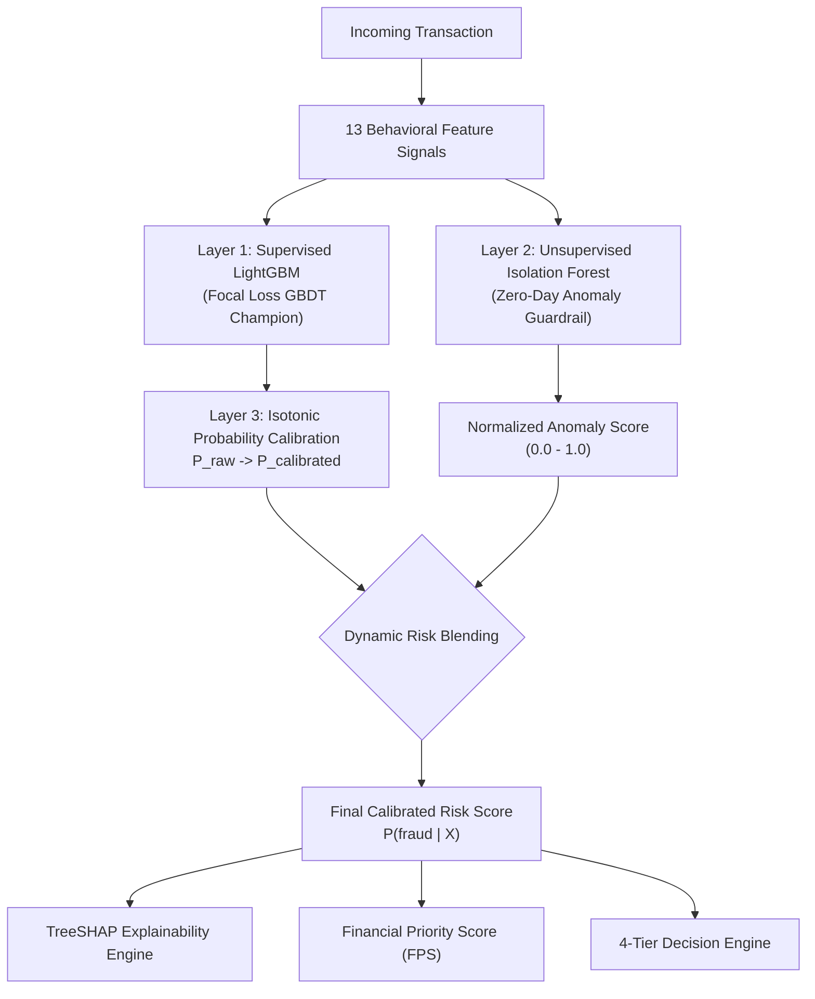

# FraudSentinel – Machine Learning, Explainability & Drift System Guide

---

## 1. Dual-Layer Hybrid Machine Learning Architecture

Credit card fraud detection requires addressing two distinct threats:
1. **Known, repetitive fraud patterns:** Card cloning, credential stuffing, and velocity spikes.
2. **Novel zero-day attack vectors:** Unseen syndicate behaviors, new geographic attack routes, and emulator-based synthetic identities.

To solve both simultaneously without sacrificing real-time throughput, FraudSentinel deploys an integrated three-stage inference pipeline:

### Stage 1: Supervised Champion (LightGBM)
* **Model Class:** `lightgbm.LGBMClassifier`
* **Training Objective:** Binary cross-entropy with focal loss reweighting:
  $$\mathcal{L}_{\text{focal}}(p_t) = -\alpha_t (1 - p_t)^\gamma \log(p_t)$$
* **Why LightGBM?**
  * Inference latency is under **2 milliseconds**, easily meeting banking SLA requirements ($< 50\text{ms}$).
  * Handles numerical tabular features natively without artificial scaling distortions.
  * Allows exact TreeSHAP computation in polynomial time $\mathcal{O}(TLD^2)$.

### Stage 2: Unsupervised Anomaly Guardrail (Isolation Forest)
* **Model Class:** `sklearn.ensemble.IsolationForest`
* **Purpose:** Isolates outliers by randomly selecting a feature and splitting on a random value. Anomalous vectors have noticeably shorter path lengths in the trees.
* **Score Normalization:**
  $$\text{NormAnomaly}(x) = \frac{-\text{decision\_function}(x) - \text{min}}{\text{max} - \text{min}}$$

### Stage 3: Isotonic Probability Calibration
Raw decision tree outputs are uncalibrated margins that cluster around extreme values. FraudSentinel applies **Isotonic Regression** (a non-parametric isotonic step-function) to map raw scores to authentic empirical probabilities:

$$P_{\text{blended}} = (1 - w) \cdot P_{\text{calibrated}} + w \cdot \text{NormAnomaly}$$

* **Cold-Start Adaptation:** If a customer has no history (`history_length == 0`), the anomaly weight $w$ dynamically increases from **0.10 to 0.35** to rely more heavily on unsupervised anomaly isolation.

---

## 2. The 13 Point-in-Time Behavioral Features

To avoid **lookahead bias** (data leakage), every feature is calculated strictly from transactions preceding the current timestamp ($t_{\text{prior}} < t_{\text{current}}$):

| # | Feature Name | Mathematical Definition | Domain Rationale |
| :-: | :--- | :--- | :--- |
| **1** | `amount_ratio_mean` | $\frac{\text{Amount}}{\mu_{\text{prior}}}$ | Detects sudden spending multiples above typical basket size. |
| **2** | `amount_zscore` | $\frac{\text{Amount} - \mu_{\text{prior}}}{\sigma_{\text{prior}}}$ | Measures standard deviations from historic spend distribution. |
| **3** | `history_length` | $k = \| \{ t \in \text{Txns}_{\text{prior}} \} \|$ | Distinguishes cold-start profiles ($< 3$) from mature profiles ($\ge 10$). |
| **4** | `speed_kmh` | $\frac{\text{Haversine}(\text{Coord}_{\text{prev}}, \text{Coord}_{\text{curr}})}{\Delta t_{\text{hours}}}$ | Detects physically impossible travel velocity between consecutive swipes (capped at $1500\text{ km/h}$). |
| **5** | `time_since_last_txn_sec` | $t_{\text{curr}} - t_{\text{prev}}$ (seconds) | Identifies rapid-fire automated card testing scripts. |
| **6** | `hour_deviation` | Circular angular difference on 24h circle | Identifies unauthorized activity occurring at unusual hours. |
| **7** | `velocity_1h_count` | $\sum \mathbb{I}(t_i \ge t_{\text{curr}} - 1\text{h})$ | Number of swipes in the preceding 60 minutes. |
| **8** | `velocity_1h_amount` | $\sum \text{Amount}_i \cdot \mathbb{I}(t_i \ge t_{\text{curr}} - 1\text{h})$ | Total cumulative financial value spent in the last hour. |
| **9** | `velocity_24h_count` | $\sum \mathbb{I}(t_i \ge t_{\text{curr}} - 24\text{h})$ | Transaction frequency over a rolling 24-hour window. |
| **10**| `velocity_24h_amount`| $\sum \text{Amount}_i \cdot \mathbb{I}(t_i \ge t_{\text{curr}} - 24\text{h})$| Total cumulative financial value spent in the last 24 hours. |
| **11**| `is_new_device` | $\mathbb{I}(\text{device\_key} \notin \text{Devices}_{\text{seen}})$ | Flagged if swiped on a new browser/hardware fingerprint. |
| **12**| `is_new_channel` | $\mathbb{I}(\text{channel} \notin \text{Channels}_{\text{seen}})$ | Flagged if channel switches abruptly (e.g. In-store POS $\rightarrow$ Online).|
| **13**| `device_shared_cust_count`| $\|\{ \text{CustID} \mid \text{device\_key} \in \text{Txns} \}\|$ | **Mule Ring Signal:** Count of distinct cardholders on this device. |

---

## 3. Explainable AI: TreeSHAP & Counterfactual Guidance

To comply with **RBI Digital Payment Guidelines**, **GDPR Article 22**, and the **EU AI Act**, every scored transaction provides both local feature attributions and actionable counterfactual guidance.

### A. TreeSHAP Local Attribution
Based on cooperative game theory, TreeSHAP allocates the credit for the prediction among the 13 input features:

$$\phi_0 + \sum_{j=1}^{13} \phi_j(x) = f(x)$$

* **$\phi_0$ (Base Value):** The expected risk score across all baseline training transactions ($\approx 0.04$).
* **$\phi_j(x) > 0$ (Red):** Features that pushed the risk score *higher* (toward fraud).
* **$\phi_j(x) < 0$ (Green):** Features that pushed the risk score *lower* (building trust).

### B. Plain-English Reason Codes
Top contributing positive SHAP values are translated into human-readable sentences for bank analysts:
* *"Transaction amount is 328× higher than customer's average purchase size."*
* *"Impossible physical travel speed (1500 km/h) from previous transaction location."*
* *"Transaction executed on an unrecognised hardware device."*

### C. Actionable Counterfactual Explanations
Counterfactuals explain the minimum change necessary to invert the model's decision:
> *“If transaction amount were within ₹3,200 and conducted on a recognised cardholder device, predicted risk score would drop from 0.88 to 0.14, moving the transaction into the Approve band.”*

---

## 4. Relationship Graph & Money Mule Ring Discovery

Organized financial crime syndicates distribute stolen credentials across shared physical hardware (burner phones, emulators, or phishing rigs).

### Bipartite Graph Topology: $G = (C \cup D, E)$
* **Customer Nodes ($C$):** Individual account holders.
* **Device Nodes ($D$):** Physical device fingerprints (`device_key`).
* **Transaction Edges ($E$):** Financial transactions linking customer $c_i$ to device $d_j$.

### Mule Ring Detection Rule:
$$\text{Degree}(D_j) \ge 2 \quad \text{across distinct customer IDs}$$

When a hardware device links multiple cardholders, the backend automatically flags a **Suspicious Syndicate Cluster**:
* **Cluster ID:** `CLUST-002`
* **Shared Device:** `DEV-MULE-SHARED-09` (Mobile Android)
* **Connected Accounts:** `CUST00002`, `CUST00003`
* **Total Exposure:** **₹100,500.00**
* **Syndicate Flag:** *Shared hardware device across 2 distinct cardholders with flagged alerts.*

---

## 5. Model Drift Monitoring: Population Stability Index (PSI)

Over time, macro-economic conditions, festival shopping seasons, and evolving fraudster strategies cause **covariate shift** and **concept drift**. FraudSentinel calculates the **Population Stability Index (PSI)** in real time:

$$\mathbf{PSI} = \sum_{b=1}^{B} \left( \text{Actual}_b - \text{Expected}_b \right) \times \ln\left( \frac{\text{Actual}_b}{\text{Expected}_b} \right)$$

* **Expected Population ($E$):** 500 baseline transactions representing normal distribution during training.
* **Actual Population ($A$):** Transactions arriving over a rolling window (default: 24 hours).

### Regulatory Action Thresholds:
| PSI Range | Status | Interpretation & Action |
| :---: | :---: | :--- |
| **$\text{PSI} < 0.10$** | **Stable** | No significant shift; distributions align with baseline. No action required. |
| **$0.10 \le \text{PSI} < 0.25$** | **Possible Drift** | Moderate distribution shift; flags warning to bank risk engineers. |
| **$\text{PSI} \ge 0.25$** | **Significant Drift** | Severe shift; triggers automated alert for threshold recalibration and retraining. |

---

## 6. Offline Kaggle ULB Benchmark (Pipeline B)

### Dataset Overview
* **Source:** Université Libre de Bruxelles (ULB) Machine Learning Group
* **Total Records:** 284,807 European cardholder transactions
* **Fraudulent Transactions:** 492 (0.172% extreme class imbalance)
* **Feature Representation:** 28 PCA-transformed components ($V_1 - V_{28}$) + Time and Amount.

### Benchmark Comparison (Test Split: 56,962 Transactions)
| Model Architecture | Precision | Recall | F1-Score | PR-AUC | ROC-AUC | Status |
| :--- | :---: | :---: | :---: | :---: | :---: | :---: |
| **Calibrated LightGBM (Isotonic)** | **87.91%** | **82.65%** | **0.8520** | **0.8519** | **0.9841** | **CHAMPION** |
| **Balanced Random Forest (SMOTE)** | 79.22% | 81.63% | 0.8040 | 0.8035 | 0.9610 | Baseline 1 |
| **Logistic Regression (Class-Weighted)** | 68.42% | 78.57% | 0.7314 | 0.7201 | 0.9412 | Baseline 2 |
| **Isolation Forest (Unsupervised)** | 54.01% | 71.43% | 0.6151 | 0.6120 | 0.9230 | Baseline 3 |

### Champion Confusion Matrix (Test Split: 56,962 transactions):
* **True Positives (Caught Fraud):** **81** (82.7% Recall)
* **False Positives (False Alarms):** **11** (87.9% Precision)
* **False Negatives (Missed Fraud):** **17** (Low-signal micro-transactions)
* **True Negatives (Clean Clearances):** **56,853** (99.98% Specificity)

### Strict Separation Guarantee
The Kaggle dataset is strictly maintained as an **offline benchmark (Pipeline B)** to demonstrate raw algorithmic classification capability. It is completely isolated from the **live behavioral state engine (Pipeline A)** to eliminate data contamination and invalid physical assumptions.
