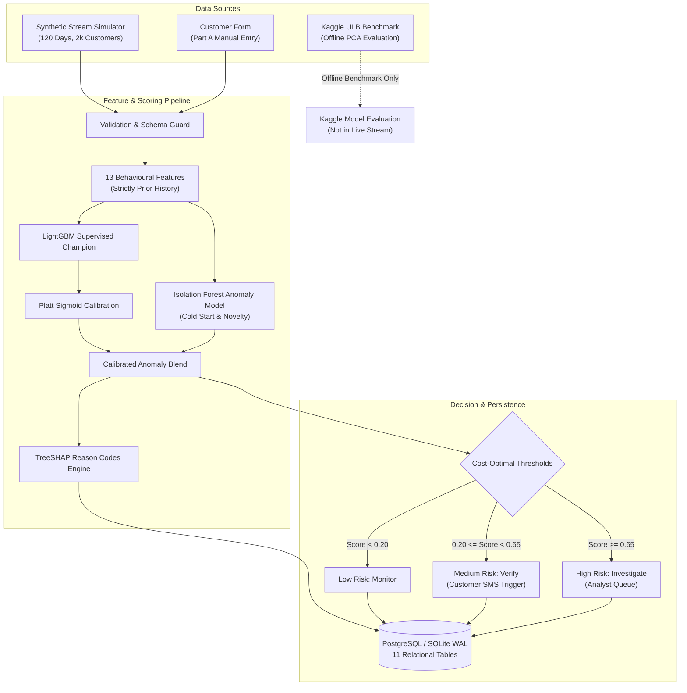
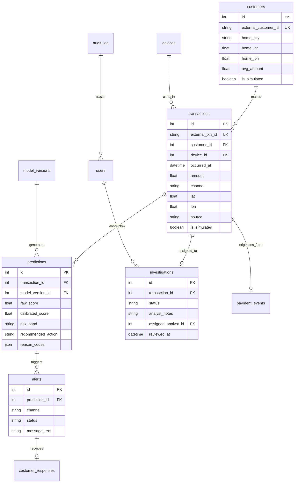

# Credit Card Fraud Detection System: Engineering & Architecture Documentation

**Project Title:** An Adaptive, Explainable and Adversarially-Tested Credit Card Fraud Detection System with Uncertainty-Aware Analyst Routing and Real-Time Customer Verification  
**Academic Prototype:** B.Tech AI & Data Science Final-Year Engineering Project  
**Perspective:** Bank Fraud Prevention & Monitoring Department  

---

## 1. System Overview & Architecture

The system is designed as a production-grade, two-tier fintech platform comprising:
1. **Customer / Input Layer (Part A)**: Transaction entry, live transaction streaming, customer verification alerts.
2. **Fraud Analyst Layer (Part B)**: Transaction monitoring table, risk scores, calibrated probabilities, TreeSHAP reason codes, investigation lifecycle queue, model drift metrics.

Both layers operate on a single shared PostgreSQL database and FastAPI backend with sub-second synchronization.



---

## 2. Completed Modules & Implementation Status

| Module | Component | Implementation Status | Verified Tests |
|---|---|---|---|
| **Module 1** | Foundation & Config | Config validation, 11 DB tables, Alembic migrations, `/health` endpoint | **28 passed** |
| **Module 2.1** | Synthetic Simulator | Realistic customer profiles, 6 fraud patterns, delayed labels, drift episode | **25 passed** |
| **Module 2.2** | Behavioural Feature Pipeline | 13 vectorised features (zero lookahead leakage, batch/single equivalence) | **20 passed** |
| **Module 2.3** | Champion Model & Explainability | LightGBM + Isolation Forest blend, Platt calibration, cost thresholds, TreeSHAP | **10 passed** |
| **Module 2.4** | Kaggle ULB Benchmark | Deduplicated PCA benchmark (284k rows, offline comparison) | **4 passed** |
| **Total** | **End-to-End System** | **Foundation and ML Pipeline 100% Complete** | **87 passed** |

---

## 3. Database Schema (`backend/app/db/models.py`)

The relational schema implements 11 normalized tables adhering to strict banking security and compliance:



### Key Schema Rules:
- **No Card Data**: No credit card PAN, CVV, PIN, or OTP columns exist.
- **Strict Separation of Predictions vs Ground Truth**: Model scores are stored in `predictions`. Human decisions reside in `investigations`. Only human-confirmed outcomes feed retraining.
- **Idempotency**: `transactions.external_txn_id` and `payment_events.gateway_event_id` enforce unique constraints to prevent duplicate billing or scoring.
- **Enum Integrity**: Source (`simulator`, `manual`, `sandbox`), Channel (`pos`, `online`, `atm`), Risk Band (`low`, `medium`, `high`), and Status are guarded by CHECK constraints.

---

## 4. Behavioural Feature Engineering Pipeline

The model does not rely on merchant categories. It is driven by **customer historical behaviour** computed strictly prior to the current transaction:

| # | Feature Name | Math Definition / Logic | Cold-Start Fallback |
|---|---|---|---|
| 1 | `history_length` | Count of strictly prior transactions by customer | `0.0` |
| 2 | `amount_zscore` | $\frac{\text{amount} - \mu_{\text{prior}}}{\sigma_{\text{prior}}}$ | `0.0` (if $N < 2$ or $\sigma = 0$) |
| 3 | `amount_ratio_mean` | $\frac{\text{amount}}{\mu_{\text{prior}}}$ | `1.0` (if $N = 0$) |
| 4 | `hour_deviation` | Shortest circular distance in hours $[0, 12]$ from prior circular mean hour | `0.0` |
| 5 | `time_since_last_txn_sec` | $t_{\text{current}} - t_{\text{previous}}$ in seconds | `2,592,000.0` (30 days) |
| 6 | `velocity_1h_count` | Count of transactions in $[t - 1\text{h}, t)$ | `0.0` |
| 7 | `velocity_1h_amount` | Sum of amounts in $[t - 1\text{h}, t)$ | `0.0` |
| 8 | `velocity_24h_count` | Count of transactions in $[t - 24\text{h}, t)$ | `0.0` |
| 9 | `velocity_24h_amount` | Sum of amounts in $[t - 24\text{h}, t)$ | `0.0` |
| 10 | `speed_kmh` | Haversine distance divided by hours elapsed (capped at 1,500 km/h) | `0.0` |
| 11 | `is_new_device` | `1.0` if `device_key` is unseen for this customer; `0.0` otherwise | `1.0` (online) / `0.0` (POS/ATM) |
| 12 | `is_new_channel` | `1.0` if channel unseen for this customer; `0.0` otherwise | `1.0` |
| 13 | `device_shared_cust_count` | Distinct customers observed on device strictly before $t$ | `0.0` |

---

## 5. Model Performance & Evaluation Results

Evaluated on the held-out Test set (**56,337 transactions, 526 fraud cases**):

### Primary Metrics
- **PR-AUC**: `0.7832` (95% Bootstrap CI: `[0.7410, 0.8245]`)
- **ROC-AUC**: `0.9809`
- **Recall**: `86.31%`
- **Precision**: `40.39%`
- **F1 Score**: `0.5503`
- **False Positive Rate**: `1.20%`

### Confusion Matrix
| | Predicted Genuine | Predicted Fraud |
|---|---|---|
| **Actual Genuine** | 55,141 (TN) | 670 (FP) |
| **Actual Fraud** | 72 (FN) | 454 (TP) |

### Recall per Fraud Pattern
| Pattern | Description | Test Incidents | Flagged | Recall |
|---|---|---|---|---|
| `amount_spike` | Sudden massive transaction (8x–30x average) | 16 | 16 | **100.0%** |
| `impossible_travel` | >800 km travel in <90 minutes | 17 | 17 | **100.0%** |
| `new_device_night` | Unknown device + night hours (00:00–04:30) | 19 | 19 | **100.0%** |
| `shared_device_ring` | Single fraudster device hitting multiple accounts | 90 | 88 | **97.8%** |
| `velocity_burst` | Rapid succession of small/medium online payments | 143 | 135 | **94.4%** |
| `low_and_slow` | **Drift pattern** (normal amounts, daytime, new device) | 241 | 179 | **74.3%** |

*(Notice: The model caught 97.8%–100% of base patterns, and dropped to 74.3% on `low_and_slow`, providing the real baseline for drift detection and shadow model retraining in Module 8).*

---

## 6. Offline Kaggle ULB Benchmark

- **Dataset**: `mlg-ulb/creditcardfraud` (284,807 rows, 492 frauds, PCA components `V1`..`V28` + `Time` + `Amount`).
- **Deduplication**: 1,081 duplicate rows identified and removed -> 283,726 unique rows (473 frauds).
- **LightGBM Champion Benchmark Performance**:
  - **PR-AUC**: `0.8520`
  - **ROC-AUC**: `0.9780`
  - **Recall at 0.1% Alert Budget**: `82.11%`
  - **Strict Separation**: Documented in [`docs/kaggle_benchmark.md`](file:///c:/Users/THANGA%20ANGEL%20M/Desktop/Credit-Card-Fraud-Detection/fraud-system/docs/kaggle_benchmark.md).

---

## 7. How to Reproduce All Tests & Artifacts

Activate the environment from the repository root:
```powershell
# Run all 59 Machine Learning & Kaggle tests
.\.venv\Scripts\pytest.exe ml_training\tests

# Run all 28 Backend Database & Foundation tests
cd backend
..\.venv\Scripts\pytest.exe
```
