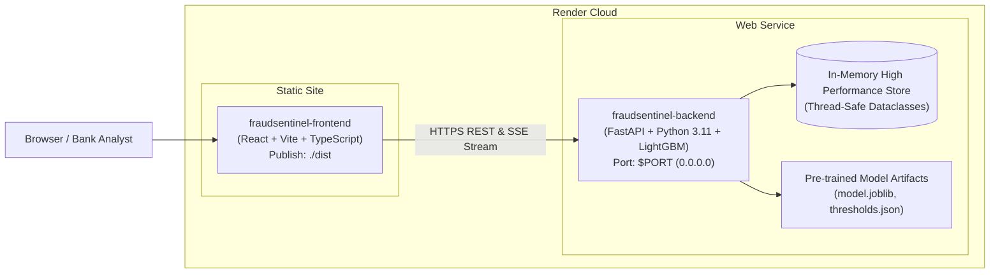

# FraudSentinel – Render-Only Production Deployment Guide

This guide details the exact step-by-step procedure to deploy both the **FraudSentinel Backend API** and **FraudSentinel Frontend Dashboard** on **Render** using zero external databases (Docker, PostgreSQL, MongoDB, Redis, and SQLite file locks are completely eliminated).

---

## Architecture Overview



---

## 1. Prerequisites

1. A free or paid account on [Render.com](https://render.com).
2. The Git repository containing the complete `Credit-Card-Fraud-Detection/fraud-system` project pushed to GitHub or GitLab.
3. Node.js 18+ and Python 3.10+ installed locally (for local verification).

---

## 2. Blueprint Deployment (`render.yaml` - 1-Click Method)

The project includes a root [`render.yaml`](../render.yaml) that automatically provisions both services:

1. Log in to your Render Dashboard.
2. Click **Blueprints** → **New Blueprint Instance**.
3. Connect your Git repository.
4. Render will parse `render.yaml` and detect two services:
   - **`fraudsentinel-backend`** (Python Web Service)
   - **`fraudsentinel-frontend`** (Static Site)
5. Click **Apply**. Render will build and deploy both services automatically.

---

## 3. Manual Deployment Instructions (Step-by-Step)

If configuring services manually via the Render UI:

### Step 3.1: Deploy Backend Web Service

1. On the Render Dashboard, click **New +** → **Web Service**.
2. Connect your repository.
3. Configure settings:
   - **Name:** `fraudsentinel-backend`
   - **Region:** Choose the region closest to you (e.g., Singapore, Frankfurt, Oregon).
   - **Branch:** `main` (or your active branch).
   - **Root Directory:** `backend`
   - **Runtime:** `Python 3`
   - **Build Command:** `pip install -r requirements.txt`
   - **Start Command:** `uvicorn app.main:app --host 0.0.0.0 --port $PORT`
   - **Plan:** Free (or Starter).
4. Expand **Advanced** → **Environment Variables**:
   - `APP_ENV` = `prod`
   - `LOG_LEVEL` = `INFO`
   - `SECRET_KEY` = `generate a random 32-character string`
   - `MSG91_AUTH_KEY` = *(Optional: paste your real MSG91 AuthKey, or omit for simulation mode)*
   - `MSG91_SENDER_ID` = `FSNTNL` *(Optional)*
   - `MSG91_FLOW_ID` = *(Optional)*
5. Set **Health Check Path** to `/health`.
6. Click **Create Web Service**.
7. Note down your backend URL (e.g., `https://fraudsentinel-backend.onrender.com`).

---

### Step 3.2: Deploy Frontend Static Site

1. On the Render Dashboard, click **New +** → **Static Site**.
2. Connect your repository.
3. Configure settings:
   - **Name:** `fraudsentinel-frontend`
   - **Branch:** `main` (or your active branch).
   - **Root Directory:** `fraudsentinel-frontend`
   - **Build Command:** `npm install && npm run build`
   - **Publish Directory:** `dist`
4. Expand **Advanced** → **Environment Variables**:
   - `VITE_API_URL` = `https://fraudsentinel-backend.onrender.com` *(Use your exact backend URL from Step 3.1)*
5. Configure **Redirects / Rewrites** (required for client-side routing):
   - **Type:** `Rewrite`
   - **Source:** `/*`
   - **Destination:** `/index.html`
6. Click **Create Static Site**.

---

## 4. Verification & Testing Post-Deployment

1. **Verify Backend Health:**
   ```bash
   curl https://fraudsentinel-backend.onrender.com/health
   # Expected Output: {"status":"ok","storage":"in-memory","model_status":"loaded","customers_registered":"16"}
   ```
2. **Verify Frontend UI:**
   - Open your frontend URL: `https://fraudsentinel-frontend.onrender.com`.
   - The landing page will load with deep aubergine, ice silver, and marigold styling.
   - Click **Access Customer Simulator** (`/customer`): Submit demo transaction or click 1-click presets.
   - Click **Analyst Operations Portal** (`/analyst/login`): Log in with `analyst` / `analyst123`.
   - Inspect **Live Feed**, **Investigation Queue**, **Relationship Graph**, and **ML Model Analytics**.

---

## 5. Storage & Persistence Note

> [!IMPORTANT]
> **Academic Demonstration Persistence Notice:**
> FraudSentinel runs with a high-performance in-memory state engine. When Render reboots, scales down, or redeploys the web service, all runtime transactions and customer responses reset cleanly to the pre-seeded baseline state (Demo Customer `DEMO001`, 15 standard bank accounts, and trained LightGBM artifacts).
